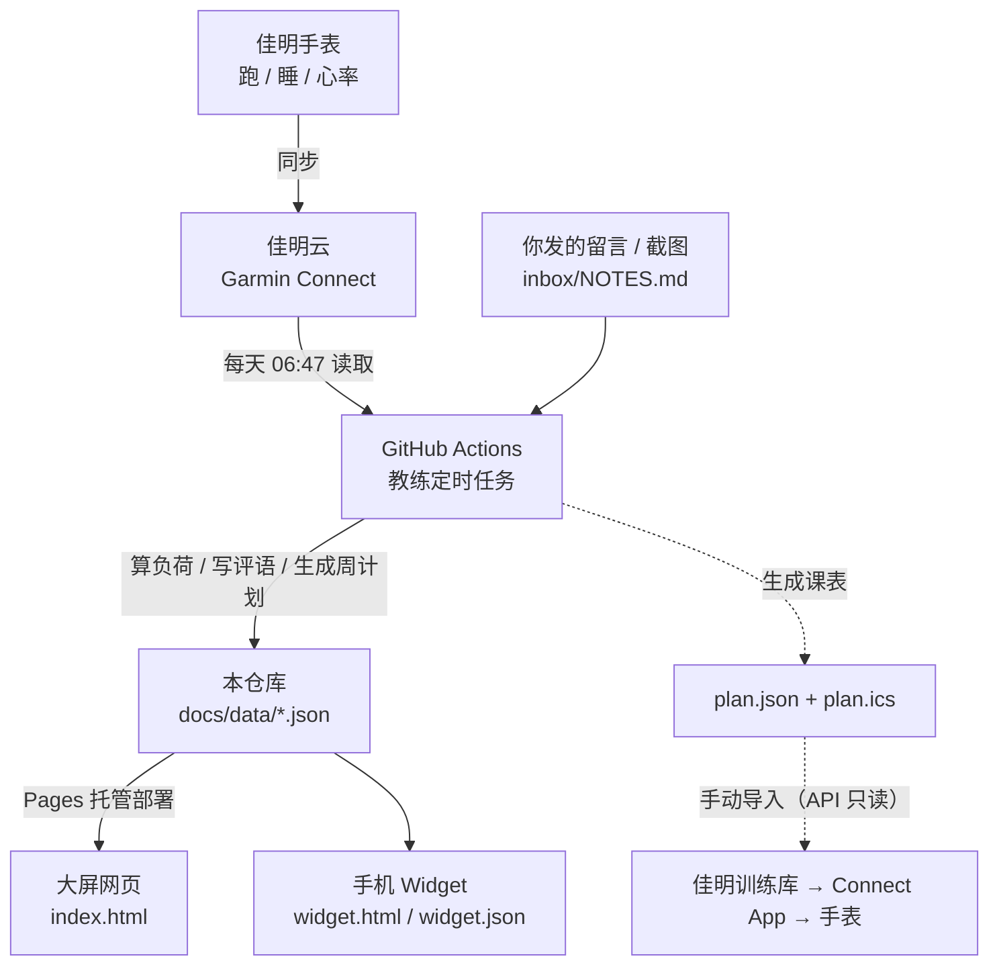

# Garmin 健康大屏 · 每日自动更新的教练看板

每天 **06:47（北京时间）** 自动从 Garmin Connect 官方 Personal API 拉取睡眠 / HRV / 卡路里数据，
交给 DeepSeek 生成趋势解读，再由「教练」模块算出训练负荷、写下评语、排好未来 7 天课表，
最后把结果编译成纯静态快照发布到 GitHub Pages。

> ⚠️ **隐私提示**：本仓库是**公开仓库**，Pages URL 任何人都能访问，其中含真实健康数据；
> 每日快照也会永久留在 git 历史中。**请勿公开分享该链接**。停止发布的方式见文末「关闭自动发布」。

## 架构链路



反向那条线（课表 → 手表）**目前不能全自动**：官方 Personal API 只有只读端点，没有写入训练计划的接口。
本站产出 ICS 日历与可直接复制的录入清单，导入步骤见 `coach.html`。

## 打开就能看

| 页面 | 地址（相对 Pages 根） | 用途 |
|---|---|---|
| 大屏 | `/` 或 `/index.html` | 4 个 KPI、睡眠 / HRV / 卡路里三张趋势图、AI 解读、异常日、相关性、本周课表 |
| 周计划 | `/coach.html` | 7 天课表、教练评语、ICS 订阅、录入清单、导入流程 |
| Widget | `/widget.html` | 紧凑小卡片，适合 iframe 或手机桌面小组件 |
| 数据 | `/data/widget.json`、`/data/plan.json`、`/data/plan.ics`、`/data/meta.json` | 供第三方小组件 / 日历订阅 / 调试 |

完整地址形如 `https://<owner>.github.io/<repo>/`。

## 每天发生了什么

1. `.github/workflows/daily.yml` 在 UTC **22:47**（= 次日北京 06:47）触发，也可在 Actions 页手动 `Run workflow`。
2. `scripts/build_site.py` 用 Secrets 注入的 Key 换取 Garmin access token，拉取近 90 天数据。
3. `normalizer.py` 做字段映射，`analyzer.py` 算趋势 / 环比 / 7 日均线 / 异常日 / 相关性。
4. `llm_interpreter.py` **只把聚合统计**发给 DeepSeek，生成睡眠 / HRV / 卡路里 / 综合四段解读。
5. `scripts/build_plan.py` 依据近 14 天 HRV 基线、睡眠评分、活动消耗判定「减量 / 维持 / 加量」，生成课表、评语与 ICS。
6. 结果写入 `docs/data/*.json`，由 workflow 提交回 `main`；Pages 从 `main /docs` 自动部署。

任何一环失败都会降级：Garmin 拉取失败 → 演示数据并标注；DeepSeek 未配置或失败 → 本地统计规则解读；
快照文件缺失 → 页面回退到内置 `demo-*.json`。**不会编造数字，也不会白屏**。

## 配置（只需一次）

进入仓库 `Settings → Secrets and variables → Actions`：

| 类型 | 名称 | 说明 |
|---|---|---|
| **Secret** | `GARMIN_PERSONAL_API_KEY` | Garmin Connect 网页版 → 设置 → Personal API Key → Create Key。Key 只显示一次，有效期 30/90/180/365 天 |
| **Secret** | `DEEPSEEK_API_KEY` | DeepSeek 平台 Key；不填则解读降级为本地规则 |
| Variable | `GARMIN_REGION` | `global`（默认）或 `cn`。**中国区账号必须设 `cn`**，主机才会切到 `personal.connectapi.garmin.cn` |
| Variable | `DEEPSEEK_MODEL` | 默认 `deepseek-flash`，可选 `deepseek-v4-pro` |
| Variable | `DEEPSEEK_BASE_URL` | 默认 `https://api.deepseek.com` |
| Variable | `SITE_LLM_RANGES` | 默认 `7,14,30,90`；设为 `30` 只给 30 天视图调模型，设 `0` 完全关闭以省 token |
| Variable | `DEEPSEEK_THINKING` | `1` 开启思考模式（更慢更贵） |

Key 只存在于 Actions 进程的环境中，**不会**进入代码、快照、日志或 Pages 页面。
公开仓库的 Actions 日志也是公开的，因此构建脚本只打印状态与条数，不打印任何健康数值或响应正文。

首次配置完，到 `Actions → 每日 06:47 生成健康快照并发布 Pages → Run workflow` 手动跑一次，
约 1–2 分钟后刷新大屏即可看到真实数据。

## 训练课表怎么到手表

- **订阅日历**：浏览器或手机日历订阅 `data/plan.ics`（URL 形如 `https://<owner>.github.io/<repo>/data/plan.ics`），每天 06:47 提醒。
- **手动录入**：`coach.html` 提供可复制的一周清单，在 Garmin Connect 网页版 → 训练 → 创建训练 / 日历中录入，同步后手表即可照着跑。
- **第三方平台**：`data/plan.json` 是结构化课表，若你用的平台有官方写入权限可自行对接。
- **不能做的**：Personal API 无写端点，无法自动写回 Connect 训练库或推送到手表。任何声称能做到的方案都要警惕使用模拟登录。

## 给教练留言

编辑 `inbox/NOTES.md`，在末尾写一句（比如「昨天踢球进了个神仙球，右腿有点酸」）并提交。
次日构建会读取最后几行并入教练评语，据此微调当周强度。截图也可放进 `inbox/` 留档，
但当前 DeepSeek 走文本接口，暂不自动识别图片。留言同样会发布到公开 Pages，请勿写敏感信息。

## 目录结构

```
.
├── .github/workflows/daily.yml   # 每日定时任务 + 手动触发
├── docs/                         # GitHub Pages 根目录（main /docs）
│   ├── index.html / app.js       # 大屏
│   ├── coach.html / coach.js     # 周计划页
│   ├── widget.html / widget.js   # 小组件
│   ├── charts.js / style.css / site.css / favicon.ico
│   └── data/                     # Actions 每日生成的 JSON / ICS 快照
├── scripts/
│   ├── build_site.py             # 主构建器：拉数 → 分析 → 解读 → 快照
│   ├── build_plan.py             # 负荷判定、评语、课表、ICS
│   └── publish_github.py         # 一次性初始化远端仓库（走 api.github.com）
├── inbox/NOTES.md                # 你的随手记
├── config.py / garmin_client.py / normalizer.py / analyzer.py / llm_interpreter.py
├── server.py / web/              # 本地桌面版（含网页设置面板，可选）
└── LOCAL_DASHBOARD.md            # 本地桌面版的完整说明
```

零第三方依赖：后端只用 Python 标准库，前端自绘 SVG 图表，不加载任何 CDN。
本地运行桌面版：`python server.py` → http://127.0.0.1:8765 ，详见 `LOCAL_DASHBOARD.md`。

## 关闭自动发布 / 清理

| 想做什么 | 怎么做 |
|---|---|
| 临时停止 | `Settings → Actions` 禁用 workflow，或在 Actions 页禁用 schedule |
| 停止拉真实数据 | 删除 `GARMIN_PERSONAL_API_KEY` Secret；构建会自动降级为演示数据 |
| 彻底下线页面 | `Settings → Pages` 关闭，或把仓库转为私有 |
| 清除历史健康数据 | 公开仓库的历史快照会留在 git 记录里，需要重写历史（`git filter-repo`）或删库重建 |

## 已知边界

- GitHub Actions 的 cron 不保证准点，高峰期可能延迟数分钟到数十分钟。
- Personal API Key 到期后要回 Connect 设置页重建并更新 Secret；token 24 小时有效、无 refresh token，代码会自动重换。
- 官方 API 下发的 .FIT 会剥离 VO2max、恢复时间等专有字段；睡眠 / HRV / 卡路里是公开字段，够用。
- 若设备返回的字段名与映射表不同，在 `normalizer.py` 的 `FIELD_CANDIDATES` 补一条候选路径；缺失值一律留空、不会补 0。
- 本看板是描述性统计分析，**不构成医疗建议或诊断**。
